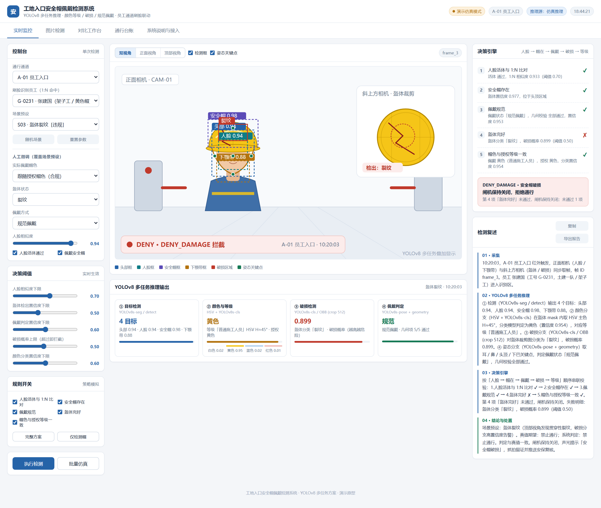
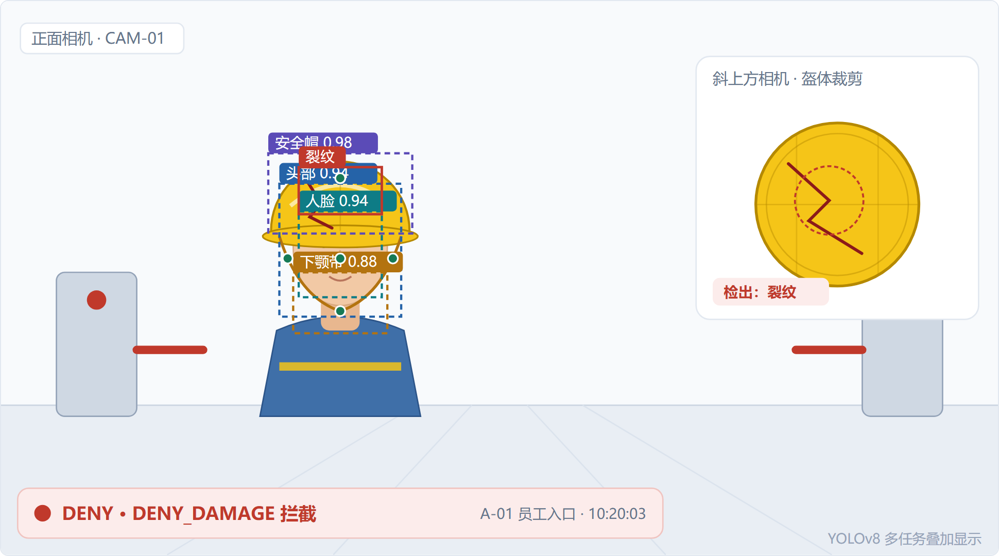
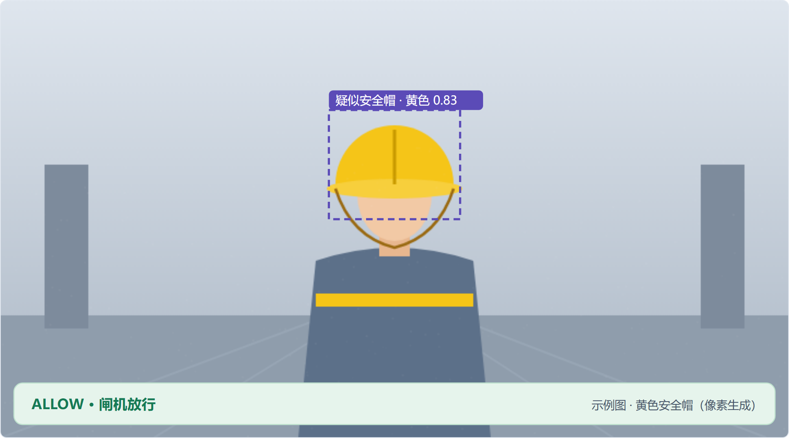
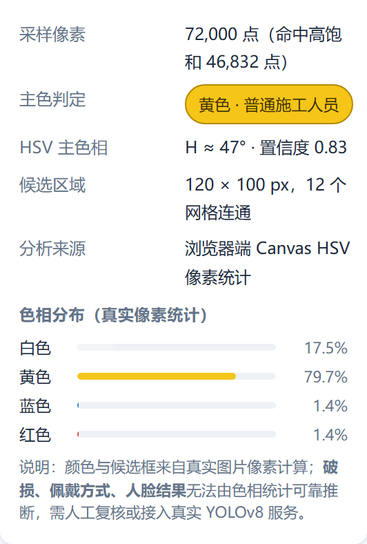
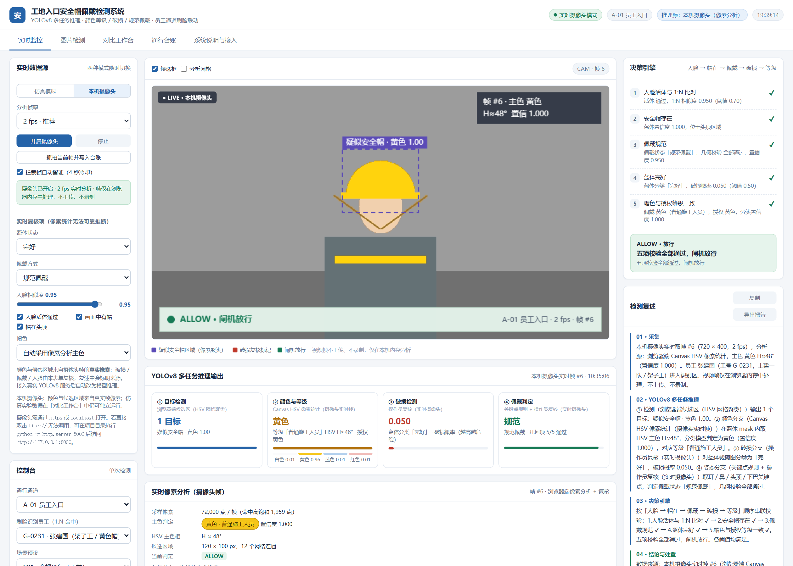
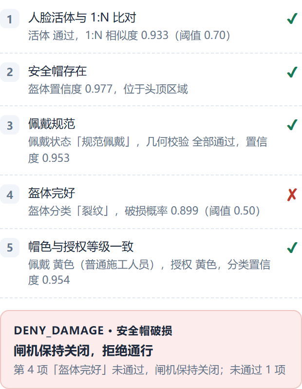
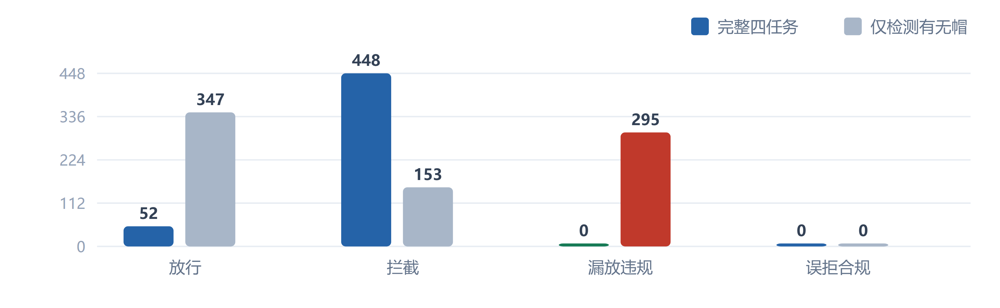

# 工地入口安全帽佩戴检测系统 · V2

基于 **YOLOv8** 的工地员工通道「刷脸 + 安全帽」联动检测系统可视化原型（第二代）。

在 V1 基础上新增三项能力：

- **外部图片导入检测**：上传 / 拖拽现场抓拍照片，读取真实像素做安全帽颜色等级判定与疑似盔体区域定位，再走完整决策链并输出中文复述。
- **本机摄像头实时演示**：「实时监控」可直接调用本机摄像头作为数据源，逐帧做真实像素分析；仿真模拟（12 场景 / 阈值 / 批量 A/B 实验）完整保留，两种数据源随时切换。
- **接入自训练权重 + 本地数据集**（2026-11-25）：把 `anquanmao.pt` 真正加载进推理服务，让「有无帽 / 佩戴规范」两路跑真实模型；把 `D:/tupian` 的 100 张图片整理成两套标准 YOLO 数据集，提供校验 / 微调 / 评估脚本。详见下文专章。

> 仓库定位：可交互的系统原型 / 方案验证平台。开箱运行的是**确定性仿真推理源 + 浏览器端真实像素分析**，无需模型权重与 GPU；摄像头为可选实时数据源；**自训练权重已随仓库提供**，装好 Python 依赖后即可把推理源切到真实模型。前端零依赖、离线可用这一点没有被改变。

---

## 新增：自训练模型与本地数据集

### 能不能导入？能，但要说清它管什么、不管什么

| 项 | 结论 |
| --- | --- |
| 权重 | `inference/weights/anquanmao.pt`，6.2 MB，SHA256 `732729d8…e1b6` |
| 来源 | Ultralytics Platform 云端训练产物，2026-11-25，`ul://ultralytics/yolov8/yolov8n` 起点 |
| 架构 / 任务 | **YOLOv8n · detect · nc=4**（Ultralytics 8.4.218，FP16 权重） |
| 类别 | `正确佩戴` / `反戴` / `未佩戴` / `佩戴非安全帽` |
| 覆盖哪几路 | **「有无安全帽」与「佩戴是否规范」两路改为真实模型推理**（检测框、置信度、状态都来自模型） |
| 不覆盖 | 颜色等级、盔体破损、人脸活体与 1:N |
| 结论 | **可以导入并已导入**：推理服务新增状态模型适配层，把 4 类状态映射到系统统一 JSON schema，前端决策链 / 台账 / 复述 / 对比界面零改动 |

**接入后不伪装成全自动**，这点很重要：

- 颜色等级：该模型没有颜色分类头，继续用**盔体框内 HSV 真实像素统计**（真算，非编造）；接入 `cls_color.pt` 后才换成分类模型。
- 盔体破损：该模型没有破损分类头，`D:/tupian` 也**没有破损样本**，服务返回 `未评估（无破损模型）` 且 `review_required=true`，界面与复述都会标注「需人工复核」，不会伪造「完好」结论。
- 人脸活体 / 1:N：由既有刷脸系统通过 `/infer` 请求参数传入，符合「不重复建设人脸库」的设计。

### 数据集：D:/tupian 做了什么

原始目录是 100 张 JPG 放根目录、100 个 TXT 放 `labels/`、`data.yaml` 里 `train: .` / `val: .` —— Ultralytics 按 `images/ → labels/` 找标签，这种布局**会找不到任何标签**，且 train/val 是同一批数据会泄漏。`tools/prepare_dataset.py` 把它重组成两套标准数据集：

| 数据集 | 内容 | 用途 |
| --- | --- | --- |
| `dataset/ppe9/` | 原始 9 类 PPE 标注全部保留 | 后续扩展（背心 / 手套等），不能直接喂给 4 类权重 |
| `dataset/helmet4/` | 按框级映射成 4 类佩戴状态 | **与 `anquanmao.pt` 类别顺序一致，可直接增量微调 / 评估** |

- 划分：按 `correct_helmet / wrong_helmet / no_helmet` 分层取 20% 作 val，`seed=42` → **train 80 / val 20**。
- 映射：`hardhat→正确佩戴(180 框)`、`hardhat_wrong→反戴(30 框)`、`no_hardhat→未佩戴(27 框)`；`person / vest / gloves` 等 817 个无关框丢弃；**「佩戴非安全帽」样本为 0，未伪造**，已在 `dataset/remap_report.json` 的 `warnings` 中写明。
- 一致性检查：100 张图的前缀类别与框级映射结果逐张核对，**异常 0 张**。

⚠️ **数据性质必须如实说明**：这 100 张是 **Simuletic 合成（synthetic）CCTV 图，不是真人真实现场照片**，许可为 **CC BY-NC 4.0（非商业、须署名）**，且不含破损样本、样本量只够小样本试验。它让系统「更真实」的含义是：训练与评估链路跑在真实图片和真实标注上、指标来自真实推理，而**不是**把仿真数字换成随机噪声。要上工地部署，仍需补采真实现场图（尤其破损类）并取得相应授权。完整说明见 `dataset/README.md`。

### 一条命令跑通

```bash
pip install -r inference/requirements.txt
python tools/verify_model.py                 # 校验权重能否加载 + 真实推理
python tools/evaluate.py                     # 在 20 张 val 上出真实 mAP
python tools/finetune.py --dry-run           # 查看增量微调命令
python inference/yolov8_service.py --port 8000
```

浏览器控制台：`App.setSource('http://127.0.0.1:8000')`。
`GET /model` 返回权重元信息，`GET /health` 返回各分支是否降级；服务已加 CORS，前端从 Pages / 本地静态服务跨域调用不会被拦。

### 「加入数据集」这一步做到哪里（如实说明）

本次**已完成**：100 张图片与标注重组为两套标准 YOLO 数据集、9→4 类框级对齐与一致性核对、
可复现的 80/20 分层划分、权重加载校验、真实评估基线，以及可直接执行的微调 / 评估脚本。

本次**没有执行完整微调训练**，原因不掩盖：

1. `anquanmao.pt` 的原始训练图片不在本机，本地只有权重，只能做「权重起点 + 新数据微调」，无法把两批原图混合重训。
2. 100 张**合成**图、且第 3 类「佩戴非安全帽」样本为 0，直接训练会弱化该类；微调前实测基线也显示明显的域偏移（见「验收结果」）。
3. 盲目在这批小样本上训练会损害原模型在自有场景上的能力，应先补采真实现场图并统一标注框口径。

推荐路径：补采真实现场图片（尤其破损与「佩戴非安全帽」类）→ 放进 `dataset/helmet4` 并重跑
`prepare_dataset.py` → 在 GPU 上 `python tools/finetune.py --epochs 50 --device 0` → 用
`tools/evaluate.py` 对比微调前后两份 JSON 做 A/B。脚本与目录结构都已就位，不需要改代码。

---

## 在线试用

| 方式 | 地址 | 说明 |
| --- | --- | --- |
| **在线（推荐）** | **https://chenjunquan798.github.io/construction-helmet-detection-v2/** | GitHub Pages（HTTPS），浏览器打开即用；摄像头也可直接调用 |
| 本地离线 | 双击仓库内 `index.html` | 零依赖，断网可用；部分浏览器在 `file://` 下会禁用摄像头 |
| 本地服务（摄像头推荐） | `python -m http.server 8765` → `http://127.0.0.1:8765/` | localhost 属安全上下文，摄像头权限正常 |

打开后建议按这条路径试：**实时监控 › 实时数据源 › 本机摄像头 › 开启摄像头** → 看实时框与决策 → 再切 **图片检测 › 生成示例图片** → 最后到 **对比工作台 › 批量仿真** 看 500 次实验数据。建议桌面端 Chrome / Edge，窗口宽度 ≥ 1200。

## 实际运行截图

以下均为本项目**实际运行页面直接截取**（Edge 无头模式，1680 px 视口，场景 S03 / 批量仿真 500 次），未做拼接或后期修改。

### 完整界面（五个标签页）



顶部为五个标签页（比 V1 多出「图片检测」），中栏为闸机通道画面，右栏为决策链与中文复述，左栏为控制台与阈值。

### 闸机画面：检出盔体裂纹 → 拒绝通行



场景 S03（盔体裂纹）：四个检测框（安全帽 / 头部 / 人脸 / 下颚带）叠加在画面上，右上角「斜上方相机·盔体裁剪」把盔体放大后标出裂纹，底部横幅给出 `DENY · DENY_DAMAGE 拦截`。

### 图片检测：导入一张图，读到什么

| 画面叠加 | 像素分析结果 |
| --- | --- |
|  |  |

左侧为导入的图片与叠加的「疑似安全帽·黄色 0.83」候选框、`ALLOW · 闸机放行` 横幅；右侧为真实像素统计：采样 72,000 点、HSV 主色相 H≈47°、候选区域 120×100 px / 12 网格连通、色相分布黄色 79.7%。面板底部也写明了破损与佩戴方式是人工复核项。

### 本机摄像头实时演示



「实时数据源」切换为**本机摄像头**后，逐帧画面直接进入分析：紫色虚线框为像素聚类定位的疑似安全帽区域（`疑似安全帽·黄色 1.00`），右上角为当前帧主色与置信度，底部横幅给出 `ALLOW · 闸机放行`；右栏五条规则与中文复述同步刷新。

> 该截图由浏览器**伪摄像头视频源**（合成帧：黄色安全帽 + 灰底）自动截取，用于验证「取流 → 逐帧像素分析 → 决策 → 复述」整条链路；接入真实摄像头后画面即为正常视频。

### 五条规则的决策链



### 批量仿真：500 次



完整四任务方案放行 52 / 拦截 448 / **漏放 0**；仅检测「有无安全帽」的传统方案放行 347 / 拦截 153 / **漏放 295**。

---

## V2 新增：图片检测

打开 **「图片检测」** 标签页：

1. 点击虚线框选择图片，或直接拖拽 `jpg / png / webp`；也可点「生成示例图片」快速体验。
2. 系统读取图片**真实像素**，右侧「像素分析结果」显示采样点数、HSV 主色相、四色占比、疑似安全帽候选区域。
3. 左侧复核表单确认破损 / 佩戴方式 / 人脸结果，点击「执行图片检测」。
4. 画面叠加候选框与破损标记，右侧输出五条决策规则与中文复述；可写入通行台账（支持复述重放）、复制、导出报告，并与场景预设做判定对比。

### 哪些是真算的，哪些需要复核

| 环节 | 实现方式 |
| --- | --- |
| 安全帽颜色等级、HSV 主色相、四色分布、疑似安全帽区域定位 | **真算**：浏览器端 Canvas 逐像素统计 + 12×8 网格连通聚类 |
| 破损、下颚带 / 反戴、人脸活体 | **需复核**：无法由色相统计可靠推断，由操作员表单填写；复述中标注「操作员复核（图片模式）」而非模型名 |
| 佩戴状态 / 目标框 / 破损复核 | 已 `App.setSource()` 接入自训练权重后，图片以 `image_b64` 发给 `/infer`，由 `anquanmao.pt` 返回真实检测框与 4 类佩戴状态，人工表单自动让位；**破损仍返回「未评估·需人工复核」**，颜色仍为盔体框内真像素统计 |

服务返回的**原图坐标**会按 `view{scale, ox, oy}` 映射到 720×400 画布再叠加。现场图若背景有大面积高饱和蓝色（安全网、工服），界面会提示主色置信度偏低并要求复核帽色，属预期行为。

---

## 本机摄像头实时演示

「实时监控」左栏顶部新增 **实时数据源**：`仿真模拟` / `本机摄像头`。切换不会影响另一侧的实验数据——仿真模式下的 12 个场景、阈值灵敏度、批量 A/B 全部照常可跑。

### 使用步骤

1. 切到「本机摄像头」，点击 **开启摄像头** 并在浏览器弹窗中允许权限（首次）。
2. 画面出现后，每帧会被绘制到 720 × 400 画布并实时分析；默认 2 fps，可切 1 / 4 fps。
3. 左栏「实时复核项」设置盔体状态、佩戴方式、人脸结果；右栏五条规则与中文复述逐帧刷新。
4. **抓拍当前帧并写入台账** 可留存证据（支持「复述重放」还原抓拍帧）；开启「拦截帧自动留证」后，判定由放行转为拦截时自动记录一次（4 秒冷却）。
5. 离开「实时监控」页签会自动停流，返回时自动恢复；点「仿真模拟」立即退出摄像头模式。

### 哪些是真算的，哪些需要复核

| 环节 | 实现方式 |
| --- | --- |
| 安全帽颜色等级、HSV 主色相、四色分布、疑似安全帽区域定位 | **真算**：摄像头帧逐像素统计（复用 `ImageLab.analyze`）+ 12×8 网格连通聚类 |
| 破损、下颚带 / 反戴、人脸活体 | **需复核**：由实时复核表单标注，模型名与复述明确写「操作员复核（实时摄像头）」 |
| 佩戴状态 / 目标框 | 已 `App.setSource()` 接入自训练权重时，每帧以 `image_b64` POST `/infer`，由 `anquanmao.pt` 返回真实检测框与 4 类佩戴状态；颜色仍为真像素统计，破损仍需复核 |

两个刻意的保守设计：

- **像素聚类找不到候选区时，检测结果显式清零**（`helmetConf = 0`），不会沿用仿真置信度，因此会判 `DENY_HELMET` 并提示「主色置信度偏低」——宁可误拦，也不放过。
- **判定与「复核标注真值」不一致时**会在复述里给出 ⚠ 提示，提醒检查阈值或复核项，而不是假装一致。

### 隐私与运行要求

- 视频帧只在浏览器内存中处理，**不上传、不录制**；仅点击「抓拍」时当前帧以内存对象写入台账，刷新页面即清除。
- 需要安全上下文：`https`（在线试用）或 `localhost`（本地静态服务）；`file://` 直开时部分浏览器会禁用 `getUserMedia`，界面会给出明确提示并保留仿真模式可用。
- 无摄像头 / 权限被拒 / 设备被占用时，会在左栏显示具体原因与处理建议，不影响仿真实验功能。

---

## 四个核心能力

| 能力 | 实现 |
| --- | --- |
| **能看** | SVG 闸机通道画面 + 图片叠加检测框 + **摄像头实时画面叠加候选框**；人物、安全帽（按等级变色）、裂纹 / 凹陷 / 缺口、下颚带、反戴 / 手持 / 倾斜，可叠加检测框、姿态关键点、顶部相机俯视图；四路 YOLOv8 输出卡片实时显示置信度 |
| **能跑** | 纯前端零依赖，双击 `index.html` 即可运行。12 个场景预设 + 6 名员工 + 5 个可调阈值 + 5 个规则开关，改参数立即重算；**本机摄像头可作实时数据源（1 / 2 / 4 fps 可调）** |
| **能对比** | A/B 场景并排、阈值灵敏度曲线、批量仿真（完整四任务 vs 仅检测有无帽）、**图片结果与场景预设判定对比**；切到摄像头时仿真实验数据仍保留可查 |
| **能复述** | 四段中文报告：采集 → 四路模型推理 → 五条规则决策链 → 结论处置；支持复制、导出 txt、台账「复述重放」（图片记录跳回图片页，**摄像头记录还原抓拍帧**） |

## 决策链

```
人脸活体 / 1:N 比对  →  帽在  →  佩戴规范  →  盔体完好  →  帽色与授权等级一致
                        任一不通过即拒闸
```

```python
if not face.live or face.score < 0.70:      return "RETRY"
if not helmet.present:                      return "DENY_NO_HELMET"
if not wear.correct:                        return "DENY_WEAR"
if damage.prob > 0.50:                      return "DENY_DAMAGED"   # 转人工复核
if helmet.color != user.authorized_color:   return "DENY_GRADE"
return "ALLOW"
```

## 技术设计要点

- **颜色与等级**：项目配置项（白=管理/监理，黄=普工，蓝=技术/特种作业，红=消防/安全/访客），刷脸后取 `authorized_color` 比对，不一致按「越权佩戴」处理。
- **破损检测**：盔体裁剪后送高分辨率分类 / OBB 模型判「完好 / 裂纹 / 凹陷 / 缺口 / 老化」；双视角互补，优先保召回率，触发后人工复核。
- **正确佩戴**：头部框、安全帽框、人脸框、下颚带 + 姿态关键点做几何规则判定，排除手持、挂背后、反戴、未扣带。
- **四路 YOLOv8 子任务**：`detect`、`cls-color`、`cls-damage`、`pose`，可独立迭代。

## 快速开始

```bash
# 方式一：直接双击 index.html（零依赖）
# 方式二：起本地静态服务
python -m http.server 8765
# 浏览器打开 http://127.0.0.1:8765/
```

建议先用「生成示例图片」跑一遍完整链路，再换成现场抓拍照片；要试摄像头，请通过 `http://127.0.0.1:8765/` 或在线地址打开（`file://` 直开时浏览器可能禁用摄像头权限）。

## 目录结构

```
index.html                    主界面（五个标签页：实时监控 / 图片检测 / 对比工作台 / 通行台账 / 系统说明）
assets/data.js                颜色等级、人员库、12 场景、规则定义
assets/engine.js              推理 / 决策 / 复述 / 批量对比引擎（含 buildResult / normalizeRemote）
assets/app.js                 画面渲染与全部交互（含图片记录重放、外部数据源刷新、切页签停流）
assets/image-lab.js           V2 新增：图片载入、像素分析、候选框、复核表单、渲染、台账 / 导出 / 重放
assets/camera-lab.js          V2 新增：摄像头取流、逐帧像素分析、叠加绘制、实时复核、抓拍台账、暂停恢复
assets/styles.css             浅色主题样式
inference/yolov8_service.py   真实 YOLOv8 推理服务（FastAPI + ultralytics），已内置自训练权重适配层
inference/weights/anquanmao.pt  自训练 YOLOv8n 4 类佩戴状态权重（6.2 MB，随仓库提供）
inference/requirements.txt
dataset/                      D:/tupian 整理出的 ppe9 / helmet4 两套标准 YOLO 数据集 + 来源与许可说明
dataset/remap_report.json     划分、类别映射统计、一致性检查与警告（可复现证据）
dataset/model_report.json     verify_model.py 的权重加载与真实推理结论
tools/prepare_dataset.py      重组 D:/tupian 为标准 YOLO 结构（可重复执行）
tools/verify_model.py         校验权重能否加载 + 真实推理 + 兼容副本生成
tools/finetune.py             以 anquanmao.pt 为起点的增量微调
tools/evaluate.py             在 val 划分上跑真实 mAP 与逐图检出明细
screenshots/                  README 所用实际运行截图（本机运行页面截取）
```

## 接入真实 YOLOv8（自训练权重已就位）

```bash
pip install -r inference/requirements.txt
python tools/verify_model.py                       # 可选：先确认权重能加载
python inference/yolov8_service.py --port 8000     # 默认加载 inference/weights/anquanmao.pt
# 有 RTSP / 本地摄像头时可加： --source rtsp://... 或 --source 0
# 用微调后的权重： --state-weights inference/weights/anquanmao_finetuned.pt
```

浏览器控制台执行：

```js
App.setSource('http://127.0.0.1:8000')
```

切换后实时监控走摄像头 / RTSP 帧、图片检测走 `image_b64`，服务输出与前端完全一致的 JSON schema，决策链与界面无需改动。

服务端的分支状态（`GET /health`）与模型元信息（`GET /model`）可随时查；`POST /infer` 响应里带有
`source_model`、`notes`、`degraded_branches`，明确写出哪些是模型算的、哪些降级了：

| 分支 | 当前实现 | 换掉的条件 |
| --- | --- | --- |
| 佩戴状态 / 目标框 | **`anquanmao.pt` 真实推理** | 已接入 |
| 颜色等级 | 盔体框内 HSV 真实像素统计 | 放入 `weights/cls_color.pt` 重启 |
| 盔体破损 | `未评估（无破损模型）` + `review_required` | 放入 `weights/cls_damage.pt` 重启 |
| 人脸活体 / 1:N | 请求参数传入（既有刷脸系统） | 现场对接 |

> `anquanmao.pt` 的 zip 内部前缀是 `best/`（Ultralytics Platform 导出格式），部分 PyTorch 版本加载会失败；
> `verify_model.py` 与推理服务都会自动重写一份 `archive/` 前缀的兼容副本 `anquanmao_compat.pt` 再加载。
> 权重是 FP16，CPU 推理前会转成 FP32，避免 Half 卷积不支持。

## 验收结果

- 12 个场景判定与真值 **100% 一致**。
- 500 次批量仿真：完整方案漏放违规 **0** 次；传统「只看有没有帽」方案漏放 **295** 次。
- 图片模式：合成像素主色 `yellow` 置信度 1.0、示例图等价像素复刻置信度 0.82，候选区域正确落在上半部；原图坐标 `x=100` 正确映射为画布 `x=190`。
- 摄像头模式（Edge 无头 + 伪摄像头视频源）：逐帧 72,000 采样点；黄色盔体帧主色 `yellow` 置信度 1.0、H≈48°、候选区 120×100 px / 12 网格，判定 `ALLOW`；无彩色帧会显式清空检测并判 `DENY_HELMET`；抓拍写入台账、切页签停流/恢复、切回复现仿真均通过。
- 校验：`node --check` 通过、Python `py_compile` 通过、jsdom 真实 DOM 运行 0 报错（含图片台账重放、摄像头无设备降级、摄像头记录重放）、109 个静态 DOM ID 无缺失、静态资源 HTTP 200。
- **自训练权重接入实测（2026-11-25）**：
  - 权重元数据：Ultralytics 8.4.218 / YOLOv8n / detect / nc=4，73 层、3,133,436 参数、8.6 GFLOPs，文件 6,494,186 B（SHA256 `732729d8…e1b6`）；PyTorch 2.15.0+cpu 直接加载成功（`best/` zip 前缀被自动识别），CPU 推理无需兼容副本。
  - 真实推理：`correct_helmet_024.jpg` 检出 4 个「正确佩戴」框（0.709 / 0.657 / 0.606 / 0.547）；`no_helmet_002.jpg` 0 框 → `helmetConf=0` 判拒；`wrong_helmet_003.jpg` 仅 0.44 低置信。
  - 端到端契约：`GET /health`（state=true，其余分支 false）、`GET /model`（真实 4 类）、`POST /infer`（image_b64）全部 200；前端 `normalizeRemote → decide → narrate` **零改动**跑通，示例输出 `DENY_COLOR`（模型给出盔体框、HSV 判白色、员工授权黄色 → 越权拦截），复述里出现真实模型名与检测框置信度。
  - 数据集：100 张 → train 80 / val 20；helmet4 共 180 正确佩戴 + 30 反戴 + 27 未佩戴框；图级前缀与框级映射一致性异常 0。
  - **真实评估基线（微调前，20 张 val）**：`imgsz=640` → P 0.598 / R 0.083 / mAP50 0.072 / mAP50-95 0.014；`imgsz=320` → P 0.167 / R 0.042 / mAP50 0.023。指标偏低是**真实结论**：原训练集为近景佩戴状态图，tupian 为远景合成 CCTV，视角与标注框口径存在明显域偏移；这正是加入本地数据集做增量微调的理由，也印证 100 张合成样本不足以训练可部署检测器。报告见 `dataset/eval_report_640.json` 与 `dataset/eval_report.json`。
  - **微调链路冒烟测试**：`python tools/finetune.py --epochs 1 --imgsz 320 --device cpu` 实测跑通（80 张 train / 20 张 val，正常产出 best.pt）。单轮后 mAP50 = 0.0218（低于微调前 0.0722，符合「小样本 + 单轮训练」预期）。**该权重仅用于验证链路，未作为交付模型发布**；完整微调需真实现场数据与 GPU，理由见上文。

## 部署建议

边缘侧 Jetson Orin Nano / 工控机 + TensorRT 或 OpenVINO，RTSP 取流，结果经 HTTP/MQTT 送闸机控制器与后台；断网时本地缓存白名单与阈值，恢复后补传日志。人脸照片与抓拍图按最小必要原则采集、加密存储、设置保留期与访问审计。

---

## 与 V1 的差异

| 项 | V1 | V2 |
| --- | --- | --- |
| 标签页 | 4 个 | 5 个（新增「图片检测」） |
| 外部图片导入 | 不支持 | 支持选择 / 拖拽 / 示例图 |
| 本机摄像头实时数据源 | 不支持 | 支持（getUserMedia，1/2/4 fps，可暂停恢复） |
| 像素级颜色分析 | 无 | 有（Canvas HSV + 网格聚类，图片与摄像头共用） |
| 图片 / 摄像头人工复核表单 | 无 | 有 |
| 图片 / 摄像头结果写入台账 / 重放 | 无 | 有（摄像头记录还原抓拍帧） |
| `assets/image-lab.js` | 无 | 新增 |
| `assets/camera-lab.js` | 无 | 新增 |
| `engine.js` | 仿真 + RTSP 帧 | 增加 `buildResult` / `normalizeRemote`、`image_b64` 上传与坐标映射 |
| `app.js` | 基础台账重放 | 增加 `imageOnly` 重放、暴露 `addHistory` / `toast` |
| 推理服务 | 帧输入，仅预留权重位置 | 补充图片模式；**已内置 `anquanmao.pt` 状态模型适配层 + CORS + `/model`**，权重随仓库提供 |
| 自训练权重 | 无 | `inference/weights/anquanmao.pt`（YOLOv8n / 4 类佩戴状态） |
| 本地数据集与工具链 | 无 | `dataset/ppe9` + `dataset/helmet4` + `tools/{prepare_dataset,verify_model,finetune,evaluate}.py` |

V1 仓库用于对比两代能力边界（[construction-helmet-detection-v1](https://github.com/chenjunquan798/construction-helmet-detection-v1)，在线试用 <https://chenjunquan798.github.io/construction-helmet-detection-v1/>）；两代各自独立、均可直接运行。
